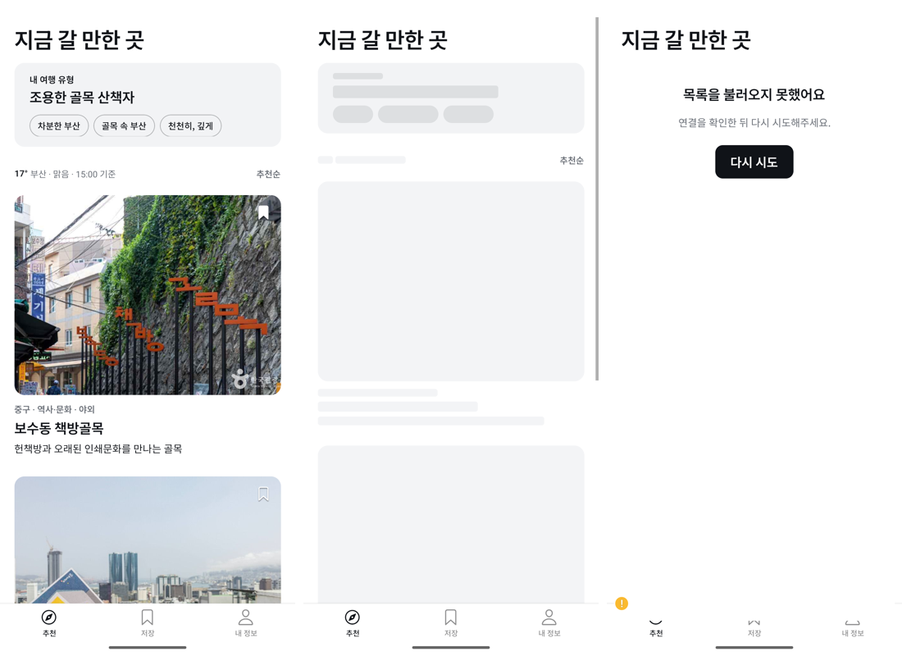

# SAIRO React Native 전환 (진행 중)

부산 방문 외국인을 위한 장소 추천 앱 [SAIRO의 Capacitor 버전](https://github.com/sairo-busan/cultural-fit-busan)을 Expo 기반 React Native로 옮기는 프로젝트입니다. 기존 앱의 동작을 확인하며 화면과 저장 방식을 전환하고 있습니다. **RN 앱은 출시 버전이 아닙니다.**

## 현재 확인한 범위

- Expo SDK 57, React Native 0.86, expo-router, NativeWind 4.2.7, TypeScript로 하단 탭 3개와 피드 화면을 구성했습니다.
- 추천 엔진·타입·데이터·문구 22개 파일 중 20개를 수정 없이 사용했습니다. 나머지 2개는 next-intl과 웹 화면 컴포넌트 타입 의존성을 분리했습니다.
- 웹 저장 로직의 동기 API를 유지하려고 MMKV를 선택했습니다. Expo Go 대신 Android dev build에서 실행했고, 앱을 강제 종료한 뒤에도 저장값이 유지되는 것을 확인했습니다.
- 웹 훅의 전역 localStorage 호출을 저장 모듈을 거치도록 바꿨습니다. 운영 API 데이터의 추천 순위가 웹과 22위까지 같았습니다.
- 피드의 사진 카드·로딩 스켈레톤·에러 안내·저장 버튼을 확인했습니다. 카드에서 상세 화면으로 들어갔다가 돌아올 수 있습니다. 비행기 모드에서 다시 시도해도 앱이 종료되지 않았고, 연결 복구 후 목록이 다시 표시됐습니다.

## 아직 이식하지 않은 범위

- RN 상세 화면은 진입·복귀만 연결했습니다. 상세 내용과 저장 탭은 아직 옮기지 않았습니다. 기존 Capacitor 앱에는 두 기능이 구현돼 있습니다.
- RN 앱은 Android 에뮬레이터에서만 실행했습니다. iOS는 아직 실행하지 않았습니다. 작업 맥은 macOS 14.5이며 Expo SDK 57에는 Xcode 26.4 이상이 필요합니다.
- 화면별 QA 시트는 아직 작성하지 않았습니다.

## 실행

Node.js 22와 Android 개발 환경이 필요합니다. MMKV는 네이티브 모듈이므로 Expo Go 대신 dev build로 실행합니다.

    npm install
    npm run android
    npx tsc --noEmit

서버 API는 원본 앱의 Vercel 배포를 호출합니다.

## 진행 방식

티켓별로 브랜치를 만들고 PR에 변경 요약·확인 내용·측정 결과를 기록했습니다. 2026년 10월 28일 기준 PR 7건을 병합했습니다. 리뷰어는 없었습니다.

세부 작업은 [티켓 문서](docs/tickets/)와 [전환 검토 문서](docs/decisions/2026-09-25_RN_전환_검토.md)에 남겼습니다.
